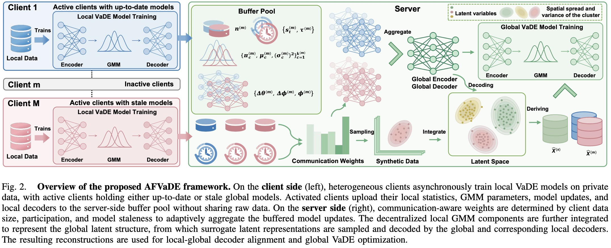

# Asynchronous Federated Variational Deep Embedding for Clustering over Heterogeneous Edge Devices
## Intro
This repo contains the code and experiment results of our proposed AFVaDE.

## Requirements
- pytorch==2.0.1
- numpy==1.25.2
- pandas==2.3.2
- scikit-learn==1.7.2
- scipy==1.15.3
- munkres==1.1.4
## How to run
```shell
python main_async.py --dataset xxx
```
**xxx: select the dataset you want to run.** 
## Example
```shell
python main_async.py --dataset iris
```
## Comparison Results

Mean ± standard deviation. **Bold** indicates the best result; *italic* indicates the second-best result (according to the original table's markings).

## Purity

| Data | k-Fed | NN-FC | FFCM | Fed-SC | FedSC | AFCL | FKDC | GOLD | SDA-FC | UIFCA | AFVaDE |
| --- | ---: | ---: | ---: | ---: | ---: | ---: | ---: | ---: | ---: | ---: | ---: |
| IR | 0.7392 ± 0.021 | 0.6330 ± 0.077 | 0.3960 ± 0.044 | 0.4920 ± 0.000 | 0.4680 ± 0.129 | 0.7160 ± 0.086 | 0.6210 ± 0.061 | 0.6864 ± 0.079 | 0.6720 ± 0.008 | *0.7620 ± 0.055* | **0.9093 ± 0.039 \\** |
| PA | 0.7538 ± 0.000 | 0.7538 ± 0.000 | 0.7538 ± 0.000 | 0.7538 ± 0.000 | 0.7538 ± 0.000 | 0.7538 ± 0.000 | *0.7540 ± 0.005* | 0.7538 ± 0.000 | 0.7539 ± 0.004 | 0.7538 ± 0.002 | **0.7543 ± 0.004 \\** |
| GL | 0.4588 ± 0.013 | 0.4302 ± 0.059 | 0.3684 ± 0.023 | 0.4214 ± 0.004 | 0.3293 ± 0.003 | 0.4542 ± 0.000 | 0.4352 ± 0.039 | 0.4757 ± 0.018 | *0.5257 ± 0.042* | 0.4584 ± 0.066 | **0.5262 ± 0.019 \\** |
| BC | 0.6754 ± 0.020 | 0.6880 ± 0.073 | 0.6274 ± 0.000 | 0.6620 ± 0.013 | 0.7390 ± 0.113 | 0.6274 ± 0.000 | 0.7790 ± 0.108 | *0.7910 ± 0.076* | 0.7102 ± 0.041 | 0.6274 ± 0.000 | **0.8517 ± 0.027 \\** |
| AU | 0.5474 ± 0.000 | 0.5596 ± 0.006 | 0.5463 ± 0.000 | 0.5637 ± 0.000 | 0.5463 ± 0.000 | 0.6269 ± 0.133 | 0.6250 ± 0.001 | 0.6268 ± 0.016 | 0.7086 ± 0.044 | *0.7121 ± 0.009* | **0.8031 ± 0.056 \\** |
| BA | *0.5954 ± 0.039* | 0.5510 ± 0.054 | 0.5057 ± 0.001 | 0.5002 ± 0.000 | 0.5125 ± 0.005 | 0.5002 ± 0.000 | 0.5427 ± 0.042 | 0.5401 ± 0.046 | 0.5556 ± 0.068 | 0.5002 ± 0.026 | **0.7638 ± 0.039 \\** |
| YE | 0.4334 ± 0.038 | 0.3040 ± 0.010 | 0.3560 ± 0.025 | 0.4288 ± 0.016 | 0.2837 ± 0.001 | 0.2808 ± 0.000 | 0.4242 ± 0.032 | 0.3899 ± 0.039 | 0.3918 ± 0.044 | *0.4785 ± 0.073* | **0.5303 ± 0.010 \\** |
| WQ | 0.4176 ± 0.004 | 0.4078 ± 0.010 | 0.4059 ± 0.008 | 0.4181 ± 0.001 | 0.3932 ± 0.000 | 0.3928 ± 0.000 | *0.4186 ± 0.004* | 0.4108 ± 0.004 | 0.4121 ± 0.014 | 0.4037 ± 0.038 | **0.4735 ± 0.027 \\** |
| DE | 0.6028 ± 0.000 | 0.6029 ± 0.000 | 0.6028 ± 0.000 | 0.6028 ± 0.000 | *0.6068 ± 0.010* | 0.6028 ± 0.000 | 0.6028 ± 0.000 | 0.6028 ± 0.000 | 0.6028 ± 0.084 | 0.6028 ± 0.018 | **0.6700 ± 0.015 \\** |
| OC | 0.4296 ± 0.001 | 0.4254 ± 0.001 | 0.4255 ± 0.000 | 0.4016 ± 0.018 | 0.3962 ± 0.063 | 0.4250 ± 0.000 | *0.4306 ± 0.000* | 0.4262 ± 0.040 | 0.4250 ± 0.073 | 0.4250 ± 0.086 | **0.4722 ± 0.014 \\** |
| RA | 0.3684 ± 0.024 | 0.3645 ± 0.011 | 0.2299 ± 0.030 | 0.3620 ± 0.006 | 0.3594 ± 0.049 | 0.1606 ± 0.000 | *0.3712 ± 0.009* | 0.3196 ± 0.004 | 0.3655 ± 0.077 | 0.3612 ± 0.029 | **0.5020 ± 0.035 \\** |
| RS | 0.3306 ± 0.009 | 0.2981 ± 0.006 | 0.2361 ± 0.006 | *0.3325 ± 0.022* | 0.3137 ± 0.071 | 0.2237 ± 0.000 | 0.3062 ± 0.004 | 0.3044 ± 0.006 | 0.3048 ± 0.047 | 0.3136 ± 0.094 | **0.3327 ± 0.023 \\** |
| PT | 0.3210 ± 0.008 | 0.2213 ± 0.030 | 0.1719 ± 0.011 | 0.3748 ± 0.014 | *0.3803 ± 0.042* | 0.1289 ± 0.000 | 0.3053 ± 0.016 | 0.2816 ± 0.013 | 0.2550 ± 0.095 | 0.2262 ± 0.095 | **0.3899 ± 0.021 \\** |
| TI | 0.3393 ± 0.013 | 0.2887 ± 0.000 | 0.2935 ± 0.001 | 0.3496 ± 0.003 | *0.3623 ± 0.090* | 0.2887 ± 0.000 | 0.3299 ± 0.010 | 0.2997 ± 0.051 | 0.3277 ± 0.015 | 0.3008 ± 0.010 | **0.3770 ± 0.026 \\** |

## ARI

| Data | k-Fed | NN-FC | FFCM | Fed-SC | FedSC | AFCL | FKDC | GOLD | SDA-FC | UIFCA | AFVaDE |
| --- | ---: | ---: | ---: | ---: | ---: | ---: | ---: | ---: | ---: | ---: | ---: |
| IR | 0.5464 ± 0.032 | 0.3684 ± 0.143 | 0.0401 ± 0.029 | 0.1669 ± 0.000 | 0.2250 ± 0.191 | 0.5300 ± 0.096 | 0.4253 ± 0.083 | 0.4608 ± 0.133 | 0.4818 ± 0.072 | *0.5774 ± 0.002* | **0.7629 ± 0.045 \\** |
| PA | -0.0580 ± 0.006 | 0.0255 ± 0.098 | -0.0042 ± 0.004 | 0.0536 ± 0.000 | -0.0062 ± 0.000 | 0.0093 ± 0.090 | 0.0783 ± 0.109 | 0.1179 ± 0.052 | *0.1229 ± 0.029* | -0.0030 ± 0.037 | **0.1386 ± 0.007 \\** |
| GL | 0.1588 ± 0.027 | 0.0985 ± 0.083 | 0.0331 ± 0.021 | 0.0802 ± 0.009 | 0.0049 ± 0.004 | 0.1413 ± 0.000 | 0.0793 ± 0.031 | 0.1788 ± 0.044 | *0.1865 ± 0.002* | 0.1463 ± 0.052 | **0.1997 ± 0.033 \\** |
| BC | 0.0682 ± 0.033 | 0.1083 ± 0.169 | 0.0039 ± 0.008 | 0.0798 ± 0.021 | 0.4102 ± 0.269 | 0.0000 ± 0.000 | *0.5180 ± 0.265* | **0.5372 ± 0.181** | 0.2918 ± 0.025 | 0.0277 ± 0.081 | 0.4922 ± 0.047 \\ |
| AU | 0.0013 ± 0.000 | 0.0154 ± 0.008 | 0.0048 ± 0.006 | 0.0202 ± 0.000 | -0.0008 ± 0.000 | 0.1728 ± 0.315 | 0.1112 ± 0.002 | 0.1154 ± 0.028 | *0.2965 ± 0.046* | 0.2946 ± 0.010 | **0.3663 ± 0.046 \\** |
| BA | *0.0982 ± 0.050* | 0.0514 ± 0.066 | 0.0112 ± 0.000 | 0.0027 ± 0.000 | 0.0167 ± 0.003 | 0.0000 ± 0.000 | 0.0437 ± 0.041 | 0.0411 ± 0.050 | 0.0459 ± 0.072 | -0.0005 ± 0.002 | **0.2779 ± 0.026 \\** |
| YE | 0.1501 ± 0.038 | 0.0229 ± 0.023 | 0.0808 ± 0.041 | 0.0788 ± 0.010 | -0.0010 ± 0.001 | 0.0000 ± 0.000 | *0.1675 ± 0.035* | 0.0725 ± 0.037 | 0.0525 ± 0.002 | 0.1390 ± 0.059 | **0.1758 ± 0.010 \\** |
| WQ | 0.0077 ± 0.006 | 0.0083 ± 0.013 | 0.0117 ± 0.009 | 0.0073 ± 0.003 | 0.0002 ± 0.000 | 0.0000 ± 0.000 | *0.0281 ± 0.007* | 0.0248 ± 0.009 | 0.0257 ± 0.099 | 0.0186 ± 0.061 | **0.0598 ± 0.003 \\** |
| DE | 0.0524 ± 0.017 | 0.0369 ± 0.033 | 0.0091 ± 0.020 | 0.0124 ± 0.004 | 0.0294 ± 0.018 | 0.0000 ± 0.000 | 0.0448 ± 0.031 | 0.0029 ± 0.014 | *0.0655 ± 0.085* | 0.0106 ± 0.041 | **0.0915 ± 0.042 \\** |
| OC | **0.0046 ± 0.001** | 0.0010 ± 0.001 | 0.0014 ± 0.002 | 0.0024 ± 0.019 | 0.0013 ± 0.012 | 0.0000 ± 0.000 | 0.0032 ± 0.001 | 0.0012 ± 0.001 | *0.0042 ± 0.023* | 0.0014 ± 0.004 | 0.0017 ± 0.017 \\ |
| RA | 0.1714 ± 0.032 | 0.1083 ± 0.005 | 0.0676 ± 0.032 | *0.1733 ± 0.002* | 0.1605 ± 0.072 | 0.0000 ± 0.000 | 0.1078 ± 0.004 | 0.1129 ± 0.016 | 0.1097 ± 0.017 | 0.1392 ± 0.022 | **0.2745 ± 0.029 \\** |
| RS | *0.1225 ± 0.016* | 0.0950 ± 0.010 | 0.0268 ± 0.021 | 0.0949 ± 0.010 | 0.0958 ± 0.083 | 0.0000 ± 0.000 | 0.0868 ± 0.008 | 0.0896 ± 0.008 | 0.0580 ± 0.046 | 0.0764 ± 0.033 | **0.1415 ± 0.028 \\** |
| PT | 0.1366 ± 0.004 | 0.0598 ± 0.019 | 0.0123 ± 0.004 | 0.1236 ± 0.015 | **0.2148 ± 0.086** | 0.0000 ± 0.000 | 0.1164 ± 0.022 | 0.0857 ± 0.019 | 0.0667 ± 0.045 | 0.0512 ± 0.042 | *0.1629 ± 0.013 \\* |
| TI | *0.0474 ± 0.008* | 0.0183 ± 0.004 | 0.0082 ± 0.001 | 0.0109 ± 0.027 | 0.0336 ± 0.012 | 0.0000 ± 0.000 | 0.0428 ± 0.004 | 0.0057 ± 0.058 | 0.0304 ± 0.040 | 0.0298 ± 0.088 | **0.0501 ± 0.032 \\** |

## NMI

| Data | k-Fed | NN-FC | FFCM | Fed-SC | FedSC | AFCL | FKDC | GOLD | SDA-FC | UIFCA | AFVaDE |
| --- | ---: | ---: | ---: | ---: | ---: | ---: | ---: | ---: | ---: | ---: | ---: |
| IR | 0.5945 ± 0.033 | 0.4465 ± 0.139 | 0.0817 ± 0.037 | 0.1896 ± 0.000 | 0.3081 ± 0.242 | 0.5792 ± 0.059 | 0.5404 ± 0.086 | 0.5171 ± 0.122 | 0.5544 ± 0.031 | *0.6075 ± 0.011* | **0.7709 ± 0.035 \\** |
| PA | 0.0418 ± 0.006 | 0.0970 ± 0.056 | 0.0027 ± 0.004 | 0.0621 ± 0.000 | 0.0044 ± 0.000 | 0.1354 ± 0.073 | 0.1253 ± 0.076 | *0.1886 ± 0.040* | 0.1706 ± 0.050 | 0.0002 ± 0.000 | **0.1981 ± 0.040 \\** |
| GL | 0.2831 ± 0.035 | 0.2074 ± 0.099 | 0.0884 ± 0.032 | 0.1708 ± 0.015 | 0.0473 ± 0.004 | 0.2659 ± 0.000 | 0.1726 ± 0.039 | 0.3095 ± 0.038 | *0.3375 ± 0.062* | 0.2581 ± 0.081 | **0.3455 ± 0.030 \\** |
| BC | 0.0967 ± 0.041 | 0.1192 ± 0.152 | 0.0057 ± 0.003 | 0.0398 ± 0.014 | 0.3400 ± 0.221 | 0.0000 ± 0.000 | 0.3461 ± 0.221 | *0.3663 ± 0.159* | 0.2102 ± 0.015 | 0.0083 ± 0.011 | **0.3752 ± 0.085 \\** |
| AU | 0.0032 ± 0.000 | 0.0333 ± 0.015 | 0.0095 ± 0.014 | 0.0431 ± 0.000 | 0.0017 ± 0.000 | 0.1686 ± 0.276 | 0.1644 ± 0.002 | 0.1673 ± 0.030 | 0.2359 ± 0.048 | *0.2955 ± 0.056* | **0.3855 ± 0.036 \\** |
| BA | *0.0805 ± 0.047* | 0.0395 ± 0.048 | 0.0050 ± 0.000 | 0.0025 ± 0.000 | 0.0148 ± 0.003 | 0.0000 ± 0.000 | 0.0504 ± 0.034 | 0.0691 ± 0.075 | 0.0325 ± 0.015 | 0.0016 ± 0.003 | **0.2222 ± 0.012 \\** |
| YE | 0.2308 ± 0.039 | 0.0887 ± 0.028 | 0.1421 ± 0.028 | 0.1767 ± 0.012 | 0.0094 ± 0.002 | 0.0000 ± 0.000 | 0.2274 ± 0.035 | 0.1766 ± 0.035 | 0.1692 ± 0.098 | *0.2360 ± 0.085* | **0.2554 ± 0.036 \\** |
| WQ | 0.0348 ± 0.007 | 0.0272 ± 0.016 | 0.0184 ± 0.005 | 0.0306 ± 0.003 | 0.0028 ± 0.001 | 0.0000 ± 0.000 | 0.0481 ± 0.006 | 0.0420 ± 0.005 | *0.0540 ± 0.008* | 0.0398 ± 0.071 | **0.0674 ± 0.010 \\** |
| DE | 0.0346 ± 0.006 | 0.0175 ± 0.019 | 0.0130 ± 0.004 | 0.0122 ± 0.003 | **0.0483 ± 0.035** | 0.0000 ± 0.000 | 0.0276 ± 0.010 | 0.0190 ± 0.015 | *0.0389 ± 0.028* | 0.0140 ± 0.026 | 0.0240 ± 0.041 \\ |
| OC | 0.0060 ± 0.000 | 0.0007 ± 0.000 | 0.0014 ± 0.000 | *0.0066 ± 0.002* | 0.0046 ± 0.012 | 0.0000 ± 0.000 | 0.0034 ± 0.000 | 0.0017 ± 0.003 | 0.0035 ± 0.004 | 0.0025 ± 0.002 | **0.0072 ± 0.015 \\** |
| RA | *0.3758 ± 0.014* | 0.3339 ± 0.014 | 0.1199 ± 0.043 | 0.3254 ± 0.004 | 0.3334 ± 0.038 | 0.0000 ± 0.000 | 0.3609 ± 0.010 | 0.2617 ± 0.025 | 0.3232 ± 0.015 | 0.2302 ± 0.047 | **0.3902 ± 0.006 \\** |
| RS | **0.2087 ± 0.011** | 0.1781 ± 0.020 | 0.0869 ± 0.027 | 0.1890 ± 0.004 | 0.1875 ± 0.039 | 0.0000 ± 0.000 | 0.1910 ± 0.004 | *0.2032 ± 0.001* | 0.1927 ± 0.019 | 0.1754 ± 0.024 | 0.1967 ± 0.022 \\ |
| PT | 0.2496 ± 0.005 | 0.1543 ± 0.032 | 0.0505 ± 0.012 | 0.2487 ± 0.024 | *0.2708 ± 0.028* | 0.0000 ± 0.000 | 0.2565 ± 0.005 | 0.2403 ± 0.013 | 0.2167 ± 0.005 | 0.1237 ± 0.015 | **0.2747 ± 0.025 \\** |
| TI | *0.0530 ± 0.007* | 0.0277 ± 0.004 | 0.0137 ± 0.002 | 0.0226 ± 0.043 | 0.0434 ± 0.021 | 0.0000 ± 0.000 | 0.0508 ± 0.001 | 0.0199 ± 0.023 | 0.0195 ± 0.023 | 0.0272 ± 0.053 | **0.0597 ± 0.011 \\** |

## ACC

| Data | k-Fed | NN-FC | FFCM | Fed-SC | FedSC | AFCL | FKDC | GOLD | SDA-FC | UIFCA | AFVaDE |
| --- | ---: | ---: | ---: | ---: | ---: | ---: | ---: | ---: | ---: | ---: | ---: |
| IR | 0.7392 ± 0.021 | 0.6288 ± 0.080 | 0.3804 ± 0.036 | 0.4740 ± 0.000 | 0.4536 ± 0.121 | 0.7160 ± 0.086 | 0.5754 ± 0.092 | 0.6804 ± 0.088 | 0.6720 ± 0.008 | *0.7620 ± 0.055* | **0.9093 ± 0.039 \\** |
| PA | 0.6217 ± 0.010 | 0.5927 ± 0.005 | 0.5437 ± 0.005 | 0.5630 ± 0.000 | *0.6738 ± 0.000* | 0.5779 ± 0.023 | 0.5977 ± 0.077 | 0.6143 ± 0.005 | 0.6185 ± 0.008 | 0.4615 ± 0.004 | **0.6882 ± 0.012 \\** |
| GL | 0.4163 ± 0.026 | 0.3630 ± 0.064 | 0.3318 ± 0.025 | 0.3259 ± 0.010 | 0.3180 ± 0.005 | 0.4080 ± 0.000 | 0.3630 ± 0.037 | 0.4163 ± 0.037 | *0.4836 ± 0.023* | 0.3533 ± 0.017 | **0.4850 ± 0.033 \\** |
| BC | 0.6079 ± 0.020 | 0.6186 ± 0.074 | 0.5030 ± 0.005 | 0.5958 ± 0.013 | 0.7390 ± 0.113 | 0.5647 ± 0.000 | 0.7774 ± 0.111 | *0.7910 ± 0.076* | 0.7102 ± 0.041 | 0.5521 ± 0.081 | **0.8517 ± 0.027 \\** |
| AU | 0.5474 ± 0.000 | 0.5596 ± 0.006 | 0.4981 ± 0.031 | 0.5637 ± 0.000 | 0.5451 ± 0.000 | 0.6269 ± 0.133 | 0.6250 ± 0.001 | 0.6268 ± 0.016 | 0.7086 ± 0.044 | *0.7121 ± 0.009* | **0.8031 ± 0.056 \\** |
| BA | *0.5954 ± 0.039* | 0.5341 ± 0.071 | 0.5057 ± 0.001 | 0.4777 ± 0.002 | 0.5125 ± 0.005 | 0.4999 ± 0.000 | 0.5412 ± 0.044 | 0.5395 ± 0.046 | 0.5556 ± 0.068 | 0.4612 ± 0.003 | **0.7638 ± 0.039 \\** |
| YE | 0.3850 ± 0.037 | 0.2963 ± 0.011 | 0.3362 ± 0.028 | 0.3186 ± 0.016 | 0.2797 ± 0.001 | 0.2808 ± 0.000 | *0.3902 ± 0.028* | 0.3121 ± 0.041 | 0.2753 ± 0.092 | 0.3360 ± 0.087 | **0.4255 ± 0.014 \\** |
| WQ | 0.3486 ± 0.024 | 0.3589 ± 0.033 | 0.2774 ± 0.031 | 0.2485 ± 0.015 | 0.3927 ± 0.000 | *0.3928 ± 0.000* | 0.3263 ± 0.022 | 0.2893 ± 0.027 | 0.2470 ± 0.012 | 0.1883 ± 0.092 | **0.4136 ± 0.046 \\** |
| DE | 0.3186 ± 0.034 | 0.4046 ± 0.060 | 0.3272 ± 0.054 | 0.2113 ± 0.020 | 0.2509 ± 0.030 | *0.6028 ± 0.000* | 0.3091 ± 0.047 | 0.2687 ± 0.031 | 0.3691 ± 0.010 | 0.1951 ± 0.010 | **0.6295 ± 0.024 \\** |
| OC | 0.4008 ± 0.003 | 0.4246 ± 0.000 | 0.4144 ± 0.003 | 0.2723 ± 0.030 | 0.2597 ± 0.042 | 0.4250 ± 0.000 | *0.4281 ± 0.002* | 0.4107 ± 0.007 | 0.3318 ± 0.043 | 0.2705 ± 0.020 | **0.4381 ± 0.004 \\** |
| RA | *0.3684 ± 0.025* | 0.2848 ± 0.013 | 0.2203 ± 0.027 | 0.3298 ± 0.005 | 0.3182 ± 0.031 | 0.1606 ± 0.000 | 0.2815 ± 0.011 | 0.2965 ± 0.013 | 0.2738 ± 0.073 | 0.3166 ± 0.086 | **0.4183 ± 0.010 \\** |
| RS | *0.2795 ± 0.017* | 0.2729 ± 0.009 | 0.1993 ± 0.007 | 0.2517 ± 0.009 | 0.2500 ± 0.089 | 0.2237 ± 0.000 | 0.2687 ± 0.012 | 0.2543 ± 0.001 | 0.2399 ± 0.008 | 0.2221 ± 0.047 | **0.3255 ± 0.038 \\** |
| PT | 0.3143 ± 0.010 | 0.2110 ± 0.025 | 0.1671 ± 0.010 | 0.2981 ± 0.058 | *0.3674 ± 0.007* | 0.1289 ± 0.000 | 0.3011 ± 0.016 | 0.2669 ± 0.027 | 0.2550 ± 0.095 | 0.2049 ± 0.067 | **0.3867 ± 0.033 \\** |
| TI | 0.2453 ± 0.008 | 0.2604 ± 0.010 | 0.2536 ± 0.004 | 0.1661 ± 0.049 | 0.1908 ± 0.093 | 0.2887 ± 0.000 | 0.2763 ± 0.015 | 0.2677 ± 0.020 | *0.2987 ± 0.011* | 0.2011 ± 0.056 | **0.3727 ± 0.022 \\** |
